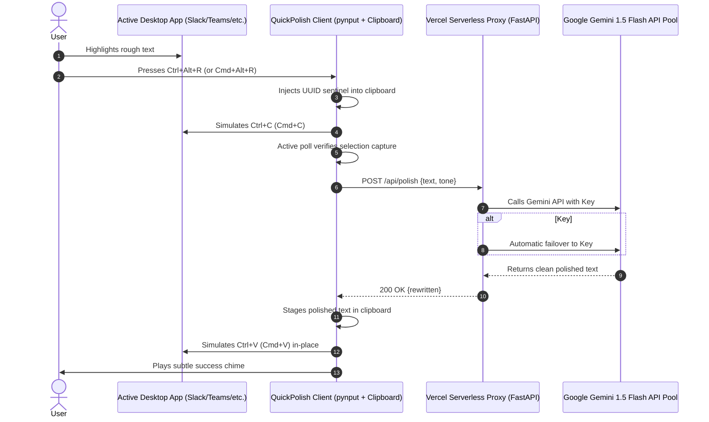

# QuickPolish ✨
> **Production-Grade, Zero-Configuration In-Place AI Rewriting Desktop Tool**

QuickPolish empowers users to highlight rough, informal, or incomplete text in **any** desktop application (Slack, Microsoft Teams, Outlook, Gmail, Google Chrome, VS Code, Word, Terminal, etc.) and instantly polish it in-place by pressing a global hotkey (**`Ctrl+Alt+R`** on Windows/Linux, **`Cmd+Alt+R`** on macOS).

---

## 🌟 Key Highlights

- **Zero-Config for End Users**: Users never touch or manage API keys. Requests route through a fast Vercel serverless proxy rotating 3–4+ Gemini Flash API keys.
- **Works in Any Application**: Native UUID sentinel clipboard polling captures selections without requiring application-specific APIs or browser extensions.
- **In-Place Instant Replacement**: The rewritten text replaces the highlighted rough text seamlessly right before your eyes.
- **Multi-Key Failover Engine**: If one Gemini API key hits a rate limit (`429 Quota Exceeded`), the proxy automatically and instantaneously rotates to the next key.
- **Portable Standalone Executable**: Generates a self-contained `.exe` (or macOS binary) via an automated `build.py` script.
- **Multiple Tones via System Tray**: Switch between *Professional*, *Casual*, *Concise*, *Executive*, *Grammar Only*, and *Bullet Points* at any time.

---

## 🏗️ Architecture & Workflow



---

## 📁 Repository Layout

```
QuickPolish/
├── server/                          # Vercel Serverless Proxy
│   ├── api/
│   │   └── index.py                 # FastAPI proxy with multi-key rotation
│   ├── requirements.txt             # Vercel dependencies
│   ├── vercel.json                  # Serverless routing config
│   └── .env.example                 # Example environment variables
├── client/                          # Desktop Client
│   ├── app.py                       # App lifecycle & single-instance lock
│   ├── core/
│   │   ├── __init__.py
│   │   ├── config.py                # Local configuration & tones
│   │   ├── clipboard.py             # Active polling, UUID sentinel & paste replacement
│   │   ├── client_api.py            # HTTP client calling Vercel proxy
│   │   └── hotkey.py                # pynput global shortcut listener
│   ├── ui/
│   │   ├── __init__.py
│   │   └── tray.py                  # pystray system tray menu (tones & settings)
│   ├── assets/
│   │   ├── generate_icon.py         # Generates sleek 64x64 & multi-res icons
│   │   ├── icon.png                 # App icon (PNG)
│   │   └── icon.ico                 # App icon (Windows ICO)
│   └── requirements.txt             # Client dependencies
├── build.py                         # Automated PyInstaller packaging script
└── README.md                        # Documentation
```

---

## 🚀 Part 1: Deploying the Vercel Serverless Proxy (`server/`)

The proxy handles rate limits, hides API keys from end users, and automatically rotates requests across 3–4 free Gemini API keys.

### 1. Get Free Gemini API Keys
1. Visit [Google AI Studio](https://aistudio.google.com/app/apikey).
2. Generate 2 to 4 free API keys (using multiple Google accounts or projects).

### 2. Deploy to Vercel

#### Method A: Using Vercel CLI
```bash
# Navigate to the server folder
cd server

# Deploy to Vercel
vercel
```

#### Method B: Git Integration
1. Push this repository to GitHub.
2. In the Vercel dashboard, click **Add New Project** and select your repository.
3. Set the **Root Directory** to `server`.

### 3. Configure Environment Variables in Vercel
In your Vercel Project Settings under **Environment Variables**, add:

| Key | Example Value | Description |
|---|---|---|
| `GEMINI_API_KEYS` | `AIzaSyA_key1...,AIzaSyB_key2...,AIzaSyC_key3...` | Comma-separated list of Gemini API keys |
| `GEMINI_MODEL` | `gemini-1.5-flash` | (Optional) Defaults to `gemini-1.5-flash` |

Once deployed, your proxy will be live at `https://your-project.vercel.app`. You can test it in your browser:
```
https://your-project.vercel.app/api
```
Response:
```json
{
  "status": "online",
  "service": "QuickPolish Serverless Proxy",
  "keys_loaded": 3,
  "model": "gemini-1.5-flash",
  "supported_tones": ["Professional", "Casual", "Concise", "Executive", "Grammar Only", "Bullet Points"]
}
```

---

## 💻 Part 2: Running the Desktop Client (`client/`)

### 1. Install Dependencies
```bash
cd client
pip install -r requirements.txt
```

### 2. Configure Proxy URL (One-Time)
Edit `~/.quickpolish/config.json` or right-click the system tray icon -> **Configure Proxy URL...**:
```json
{
  "proxy_url": "https://your-project.vercel.app",
  "tone": "Professional"
}
```

### 3. Launch the Client
```bash
python client/app.py
```
A sleek QuickPolish icon will appear in your system tray.

---

## 🎯 How to Use

1. **Highlight text** anywhere (Slack, Teams, Email, Google Docs, Terminal, etc.):
   > *"hey can u look at the thing i sent earlier need it asap thx"*
2. **Press global hotkey**:
   - **Windows / Linux**: `Ctrl + Alt + R`
   - **macOS**: `Cmd + Alt + R`
3. **Watch it transform in-place**:
   > *"Could you please review the document I shared earlier at your earliest convenience? Thank you."*

---

## 🎨 Supported Tones

Right-click the system tray icon to switch tones on the fly:
- **Professional** (Default): Polished, polite, grammatically flawless, business-ready.
- **Casual**: Friendly, warm, approachable, conversational.
- **Concise**: Eliminates fluff, compact, straight to the point.
- **Executive**: Authoritative, strategic, outcome-oriented for leadership.
- **Grammar Only**: Corrects spelling and syntax without changing your vocabulary.
- **Bullet Points**: Converts paragraphs into clean, scannable bullet points.

---

## 📦 Part 3: Packaging Standalone Executable (`build.py`)

To build a zero-dependency standalone `.exe` (or macOS app) for distribution:

```bash
# Run the automated build script from the project root
python build.py
```

The script will:
1. Verify and generate the multi-resolution icon (`.ico` / `.png`).
2. Run PyInstaller with `--onefile`, `--noconsole`, and bundled assets.
3. Output the standalone executable to:
   ```
   dist/QuickPolish.exe
   ```

Users can double-click `QuickPolish.exe` on any machine without installing Python or dependencies.

---

## 🛡️ In-Place Replacement Engine (UUID Sentinel)

Standard clipboard scripts suffer from race conditions: when `Ctrl+C` is triggered programmatically, the app cannot determine if new text was selected or if the clipboard just holds old data.

QuickPolish solves this with **Active Sentinel Polling**:
1. Stashes user's current clipboard.
2. Injects an ephemeral sentinel token: `__QP_SENTINEL_<uuid4>__`.
3. Dispatches OS copy keystroke (`Ctrl+C` / `Cmd+C`).
4. Polls clipboard every 20ms:
   - If content changes away from sentinel: **Valid text captured!**
   - If sentinel persists after timeout: **No selection made** (reverts clipboard safely).
5. On rewrite completion, replaces text via `Ctrl+V` with a calibrated micro-delay to prevent UI lag.

---

## 📄 License
MIT License. Built for speed, polish, and seamless communication.
